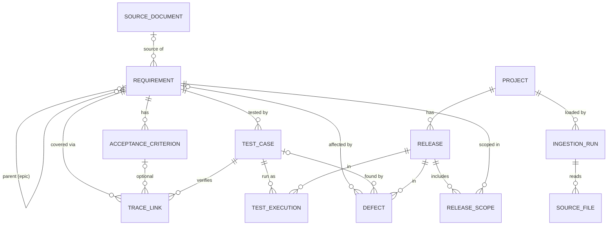

# ADR 0002: Normalized delivery model

- **Status:** Accepted
- **Date:** 2026-11-12
- **Decider:** Steve Greco
- **Issue:** W2-01
- **Builds on:** [ADR 0001](0001-stack.md) (Postgres 16, SQLAlchemy 2.0 ORM for plumbing, hand-written SQL for decisions)

## Context

The coverage, traceability and readiness logic must run on **one internal model**. Each source project (the reference CSVs, Set A Jira, Set B Kanban, Set C Mobile Banking) is translated into that model by an adapter at the boundary. Core logic never branches on which project it is (use-case §1C, §1O).

The reference data is only one shape. Set A, checked against its files, differs in ways the model must absorb:

- It has **no acceptance criteria and no test executions**. Tests in `test_cases.xlsx` point straight at a story (`Linked Story`: JTC-001 → COM-107).
- **Scope and criticality are set per epic** (`release_scope.csv`: `R24.11, COM-101, P0, Y`). Tests and bugs attach to stories.
- Its links are `implements` (45, story → epic) and `blocks` (10, bug → story).

The model also has to record **provenance**: where each row came from, and whether a human or an AI created it.

## Options considered

| Decision | Options | Chosen |
|---|---|---|
| Scope of the model | The 6 tables in `schema_ddl.sql` · all 11 reference CSVs | All 11, plus `project`, `release` and an epic level |
| Primary keys | Source IDs (`REQ-013`) · internal ID + `(project, external_id)` | Internal ID + `(project, external_id)` |
| Traceability | Copy the source (FK columns *and* a links table) · one generic polymorphic link table (`from_type/from_id`) · one typed link table with real foreign keys | Typed `trace_link` |
| Provenance | Source columns repeated on every row · ingestion-run records + row number | Ingestion-run records + `source_row` |
| AI origin fields | On every table · only where AI can create rows | Only where AI can create rows |
| Enum values | Raw only · normalized only · normalized + `raw_*` column per field · normalized + one JSON copy of the source row | Normalized + `source_payload` JSON |
| Requirement versions | Current row with version · full history table | Current row with version |
| Table definitions | ORM model classes · plain `Table` definitions | ORM classes, without `relationship()` |

**Why not the generic link table?** A `from_type/from_id` pair can't be a foreign key, so dangling links become possible, and catching those is W2-02's job. Every coverage query would also need string filters like `from_type = 'AC'`, which makes the decision SQL harder to read and defend. Set A doesn't need it either, because each Jira link type maps onto an existing column (see the mapping below).

## Decision

### Shared conventions

- **Keys.** Every loaded entity has an internal `id` (primary key), a `project_id`, and an `external_id`, with `UNIQUE (project_id, external_id)` and both `NOT NULL`. **Reports, logs and test assertions show only `external_id`** (e.g. `REQ-013`), never internal IDs.
- **Provenance.** Every loaded row has `source_file_id`, `source_row` and `source_payload` (JSONB: the original row exactly as read, with the source's own column names).
- **Normalized values.** Columns that rules depend on use one internal vocabulary, enforced by `CHECK` constraints on text columns (not Postgres `ENUM`, which is harder to change). Examples: priority `P0`–`P3`, severity `S1`–`S4`. The exact allowed values for each status column come from W2-02's data profile. Mapping source values (e.g. Jira `Highest`) to internal ones is adapter configuration, not core code.
- **Loading.** Each load truncates and rebuilds a project's data, which keeps it idempotent. Tables are created with SQLAlchemy `metadata.create_all`. There are no migrations (e.g. Alembic) yet, and the generated DDL is committed so the schema can be read as SQL.

### Entities

**Bookkeeping**
- `project`: `id`, `key` (e.g. `REFERENCE`, `SET_A`), `name`.
- `ingestion_run`: `id`, `project_id`, `adapter`, `loader_version`, `started_at`, `finished_at`.
- `source_file`: `id`, `ingestion_run_id`, `path`, `sha256`, `row_count`.

**Core: coverage and readiness rules run on these**
- `release`: `project_id`, `external_id` (e.g. `R26.10`). A lookup table with no other attributes yet.
- `requirement`: `parent_id` (self-reference, nullable, for epics), `domain`, `title`, `description`, `requirement_type`, `priority`, `status`, `approval_status`, `version` (text), `effective_date`, `owner`, `source_document_id`, `source_section`.
- `acceptance_criterion`: `requirement_id`, `criterion`, `criterion_type`, `status`, plus AI fields.
- `test_case`: `requirement_id`, `domain`, `title`, `test_type`, `preconditions`, `steps`, `expected_result`, `automation_status`, `status`, plus AI fields.
- `trace_link`: `requirement_id` (required), `acceptance_criterion_id` (**nullable**, since Set A and Set C have no ACs), `test_case_id` (required), `link_type`, `status`, plus AI fields. All three are real foreign keys.
- `test_execution`: `test_case_id`, `release_id`, `environment`, `executed_at`, `outcome`, `duration_seconds`, `build_id`, `evidence_uri`.
- `defect`: `test_case_id` (nullable), `requirement_id` (nullable), `release_id`, `severity`, `status`, `summary`, `detected_in_build`, `owner_team`.
- `release_scope`: `release_id`, `requirement_id`, `in_scope` (boolean), `release_blocking` (boolean), `criticality` (nullable, for Set A), `business_owner`, with `UNIQUE (release_id, requirement_id)`. This table is keyed by the pair, so it has no `external_id`.

**Supporting: loaded and validated, with no rules on them yet**
- `user_story`, `requirement_change`, `source_document`, `api_endpoint`, each mirroring its reference CSV's columns.

### AI origin fields

These go only on tables whose rows AI can create: **`acceptance_criterion`, `test_case`, `trace_link`**.

| Column | Meaning |
|---|---|
| `origin` | `HUMAN`, `AI_SUGGESTED` or `AI_APPROVED` |
| `created_by`, `created_at` | Who or what created the row, and when |
| `model`, `prompt_version` | For AI rows: which model and which prompt version produced it |
| `approved_by`, `approved_at` | For `AI_APPROVED` rows: who approved it, and when |

Database rules:
- `CHECK (origin = 'HUMAN' OR model IS NOT NULL)`
- `CHECK (origin <> 'AI_APPROVED' OR (approved_by IS NOT NULL AND approved_at IS NOT NULL))`

All reference and Set A data loads as `origin = 'HUMAN'`. Listing every link the AI created is then a single query: `SELECT … FROM trace_link WHERE origin <> 'HUMAN'`.

### Rules the model commits to

- **Release membership comes from `release_scope`.** `requirements.release` is kept only in `source_payload`. In the reference data the two agree for every row.
- **The coverage path is `trace_link`.** The loader checks that it agrees with `test_case.requirement_id` and reports any difference as a data-quality issue.
- **An active test means `test_case.status = 'ACTIVE'`.** `NEEDS_REVIEW` doesn't count as coverage (the G-002 lesson). A passing execution isn't required for coverage. That belongs to readiness.
- **Missing evidence is reported, never passed.** When a requirement has no executions (as with all of Set A), readiness reports **no evidence** instead of treating it as a pass.

### Worked example: mapping Set A's "Issue Key"

| Set A field | Internal model |
|---|---|
| `jira_issues.Issue Key` (e.g. `COM-107`) | `requirement.external_id`, with `project` = `SET_A` |
| `Issue Type` = Epic or Story | Both become `requirement` rows. The type is kept in `requirement_type`. |
| `Issue Type` = Bug | `defect` |
| `Parent` / link `implements` (story → epic) | `requirement.parent_id` |
| link `blocks` (bug → story) | `defect.requirement_id` |
| `Priority` (Highest/High/Medium) | `requirement.priority` (P0–P3), using a mapping table in adapter config |
| `Fix Version` | `release` |
| `release_scope.csv`: `Release, Epic Key, Criticality, In Scope` | `release_scope` on the **epic** requirement, with `criticality` and `in_scope` filled in |
| `test_cases.xlsx`: `Test ID`, `Linked Story` | `test_case.external_id`, `test_case.requirement_id`, plus a `trace_link` with no AC |
| (no ACs, no executions) | No `acceptance_criterion` rows. Readiness reports **no evidence**. |

The model doesn't decide yet how epic-level scope and criticality apply to an epic's child stories. That's a coverage-rule question for W7-02.

## Consequences

**Positive**
- One vocabulary and one coverage path for every project. Set A fits without core changes.
- Real foreign keys everywhere, so the database rejects dangling links instead of them surfacing later.
- AI-created rows are always identifiable and auditable, approvals included.
- Any value can be traced back to its file, row and load through `source_file_id`, `source_row` and `source_payload`.

**Negative / risks**
- Internal IDs mean every query joins back to `external_id` for display. That costs some readability in the decision SQL.
- More tables than the 6-table starter schema (`project`, `ingestion_run`, `source_file` and `release` are new), so W2-02's loader has more to populate.
- The reference data's 8 `epic_id` values have no epic rows. For now, reference requirements load with `parent_id = NULL`, and `epic_id` is kept in `source_payload`.
- Without migrations, schema changes mean rebuilding the database. That's acceptable while every load is a full rebuild.

**Postponed**
- Requirement version history (W6-01, if stale-test detection needs more than `version` and `effective_date`).
- How epic-level scope applies to child stories (W7-02).
- Exact `CHECK` value lists for each status column (W2-02, from the data profile).
- Migrations (when the first schema change needs to keep existing data).
