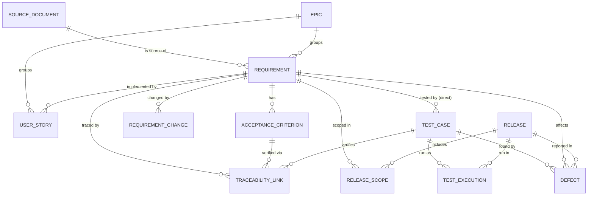

# Glossary

Definitions in my own words. Each term has an example from the reference data (`Capstone4_AI_Delivery_Assurance_Test_Engineering_Dataset/data/`) where one exists.

Template per term:

- **Definition:**
- **Example:** (an ID from the data)
- **Found in:** (CSV file and column)
- **Relates to:**

## Core chain

One row of `traceability_links.csv` shows the whole chain: `TR-00001` links REQ-001 → AC-0001 → TC-0001.

### Requirement

- **Definition:** These are basically product requirements: what the system _shall_ do, taken from a source document
- **Example:** REQ-001 (P0, `COMPLIANCE`, release R26.10, from DOC-01 §2.1)
- **Found in:** `requirements.csv`
- **Relates to:** AC, user story, release scope, source document
- **Notes:** A user story feels similar, but it's how a team slices the work for a sprint (it has `sprint` and `story_points`). An AC is the testable condition that makes a requirement checkable. Tests are written against ACs.

### Acceptance criterion (AC)

- **Definition:** The criteria that need to be met for a requirement to be considered complete
- **Example:** AC-0001
- **Found in:** `acceptance_criteria.csv`
- **Relates to:** Requirement

### Test case

- **Definition:** A case that validates AC
- **Example:** TC-0001
- **Found in:** `test_cases.csv`
- **Relates to:** AC (through traceability links), test execution
- **Notes:** `status` is `ACTIVE` or `NEEDS_REVIEW`. There is no `DEPRECATED` value.

### Test execution

- **Definition:** A specific test run
- **Example:** EX-00001 (TC-0001, release R26.11, `SIT`, `build-2224`, `PASS`)
- **Found in:** `test_executions.csv`
- **Relates to:** Test case
- **Notes:** A test case is the plan. An execution is one run of it in a given build and environment. `outcome` is `PASS`, `FAIL`, `BLOCKED` or `NOT_RUN`.

### Defect

- **Definition:** A bug / unintended case
- **Example:** DEF-0001 (S4, `IN_PROGRESS`)
- **Found in:** `defects.csv`
- **Relates to:** Test case, requirement and release (all three are columns)

### Traceability (and traceability link)

- **Definition:** Traces the links between Requirements, AC and TC. It records _which AC_ each test verifies, not just which requirement.
- **Example:** TR-00001
- **Found in:** `traceability_links.csv`
- **Relates to:** Requirement, AC, test case
- **Why it matters:** A requirement has several ACs (421 ACs for 135 requirements). `test_cases.requirement_id` only says that _some_ test touches a requirement. Without the AC-level link, a requirement with one passing test looks fully covered even if most of its ACs were never tested. In this data, 238 of 421 ACs have no linked test. This is the difference between "has a test" and "is verified."

## Release and assessment

### Release

- **Definition:** A Product release
- **Example:** R26.10 (other values: R26.11, R27.01)
- **Found in:** `release_scope.csv`, `requirements.csv`, `test_executions.csv`, `defects.csv` (`release`)
- **Relates to:** Release scope

### Release scope

- **Definition:** What we're shipping in a release. Each row also records two decisions about that requirement _for that release_: whether it blocks the release and who the business owner is.
- **Example:** R26.10 / REQ-001 / in scope / blocking / Payments
- **Found in:** `release_scope.csv`
- **Relates to:** Release, requirement
- **Notes:** It's a separate table because these are facts about the release plan, not the requirement. In this dataset, though, it's 1:1: 135 rows for 135 requirements, and the release always matches `requirements.release`.

### Release-blocking

- **Definition:** Does this requirement block a release
- **Example:** REQ-001 in R26.10 (`YES`)
- **Found in:** `release_scope.csv` (`release_blocking`)
- **Relates to:** Release scope, release readiness

### Coverage

- **Definition:** Do our test cases cover a requirement
- **Example:**
- **Found in:** Derived, not a column: requirements + ACs + traceability links + test cases
- **Relates to:** Release readiness (coverage is one input to it)
- **Notes:** This is requirement coverage, not code coverage. A test existing doesn't mean the requirement is verified. Coverage includes non-functional requirements, not just functional tests (spec line ~564).

### Readiness

There are two kinds.

#### Requirement readiness

- **Definition:** Is a requirement clear and complete enough to build and test?
- **States (spec ~line 1875):** `READY`, `CLARIFICATION_REQUIRED`, `CONFLICT_FOUND`, `INCOMPLETE`, `NOT_TESTABLE`
- **Relates to:** Requirement, AC

#### Release readiness

- **Definition:** Does the evidence support shipping this release? It's a decision about the release, not a single requirement.
- **Output:** A state, the reasons for it, and the evidence IDs behind each reason.
- **States (spec ~line 2145; I can define my own):** `READY`, `READY_WITH_RISK`, `NOT_READY`, `REVIEW_REQUIRED`, `INSUFFICIENT_EVIDENCE`
- **Notes:** `INSUFFICIENT_EVIDENCE` means there isn't enough evidence to decide either way, and it may need a human to step in.
- **Relates to:** Release scope, coverage, test executions, defects

## Supporting terms

### Priority (P0–P3)

- **Definition:** The priority of a requirement
- **Example:** REQ-001 is P0
- **Found in:** `requirements.csv` (`priority`)
- **Relates to:** Requirement, coverage gaps
- **Notes:** P0 is the highest priority.
- **Open:** Why does priority change what counts as a gap? (W2-03 only reports P0/P1 requirements with no active test. Why might a P3 with no test be acceptable?)

### Severity

- **Definition:** The severity of a bug/defect
- **Example:** DEF-0001 is S4
- **Found in:** `defects.csv` (`severity`): S1–S4
- **Relates to:** Defect, release readiness
- **Notes:** S1 is the most severe. It's defined in DOC-05 (governance), which says an open S1 is release blocking (golden scenario G-007).

### Non-functional requirement (NFR)

- **Definition:** A functional requirement is what the system does, and the non-functional is how the system does it. This is important later because that column answers what kind of behaviour it is, and what drives it
- **Example:** REQ-034 (`NON_FUNCTIONAL`, payments resiliency and operability)
- **Found in:** `requirements.csv` (`requirement_type`): `FUNCTIONAL`, `NON_FUNCTIONAL`, `SECURITY`, `COMPLIANCE`
- **Relates to:** Coverage
- **Notes:** REQ-001 behaves like a functional requirement but is typed `COMPLIANCE` because a regulation drives it.
- **Decision (for now):** Treat `SECURITY` and `COMPLIANCE` requirements like NFRs for coverage. A feature can pass every functional test and still be unready (spec line ~564).

### Epic and user story

- **Definition:** Epic is a collection of user stories
- **Example:** EPIC-01 contains US-001, which implements REQ-001
- **Found in:** `user_stories.csv`, `requirements.csv` (`epic_id`)
- **Relates to:** Requirement

### Requirement change

- **Definition:** A change to a requirement
- **Example:** CR-001 (REQ-007, `NFR_CHANGE`, target R27.01, `APPROVED`)
- **Found in:** `requirement_changes.csv`
- **Relates to:** Requirement, stale test

### Orphaned test

- **Definition:** A test that has no link to a requirement
- **Example:** None in the reference data
- **Found in:** Derived: a test with no row in `traceability_links.csv`, or a `test_cases.requirement_id` that doesn't exist in `requirements.csv`
- **Relates to:** Test case, traceability
- **Notes:** All 183 tests have a link, and every link points to a real requirement. A W2-03 report should say "0 orphans" rather than look broken. Sets A/B/C may contain some.

### Stale test

- **Definition:** A test whose passes prove an older version of the requirement. The requirement changed after the test last ran, so even a recent PASS doesn't verify the current version.
- **Example:**
- **Found in:** Derived: compare `requirement_changes.csv` (`requested_date`, `status`) and `requirements.csv` (`version`, `effective_date`) with the latest `test_executions.executed_at` for that requirement's tests. Tests have no dates of their own.
- **Relates to:** Requirement change, test execution
- **Notes:** This is different from _evidence from the wrong release_, where an execution is recorded against a different release than the requirement (e.g. EX-00001). Both make a PASS untrustworthy.
- **Open (Week 6):** Which date should count? `requested_date` is when the change was asked for, not when it took effect, and only `APPROVED` changes should matter.

### Source document (and document version/status)

- **Definition:**
- **Example:** DOC-01 (product requirements, v3.2, `CURRENT`)
- **Found in:** `document_registry.csv`, `requirements.csv` (`source_document_id`, `source_section`)
- **Relates to:** Requirement

## Noted for W1-02 (data profile)

- `release_scope.in_scope` is always `YES`. "Out of scope" means having no row.
- Every traceability link is `VERIFIES` / `ACTIVE`.
- `test_cases.status` has no `DEPRECATED` value.
- Release mismatches: REQ-001 is in R26.10, but DEF-0001 is in R27.01 and EX-00001 (its test, TC-0001) ran in R26.11.
- 238 of 421 ACs have no linked test.
- No orphaned tests: all 183 tests have exactly one traceability link.
- Test ↔ AC is 1:1 in practice: each test verifies one AC, and each linked AC has one test. The model shouldn't assume that.
- Each requirement has at most one user story (110 stories for 135 requirements).

## Concept diagram

Arrows follow foreign keys in the CSVs. `TRACEABILITY_LINK` is the join that ties a test to a specific AC. `TEST_CASE` also points straight at its requirement, so a test connects to a requirement both directly and through an AC.

`RELEASE` and `EPIC` have no CSV of their own. They exist only as ID values (`release`, `epic_id`) in other tables.
